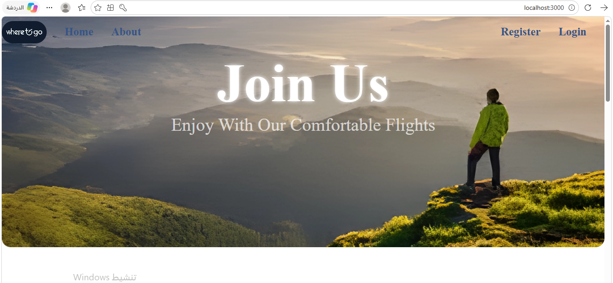
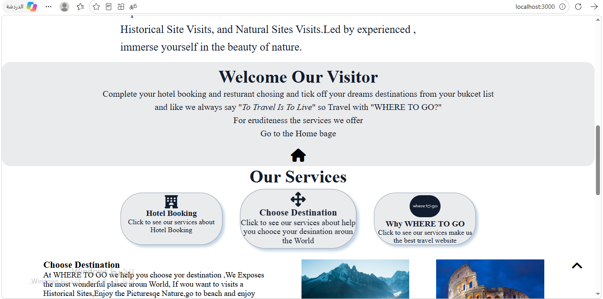
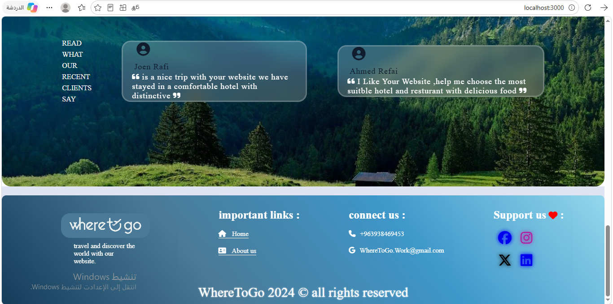
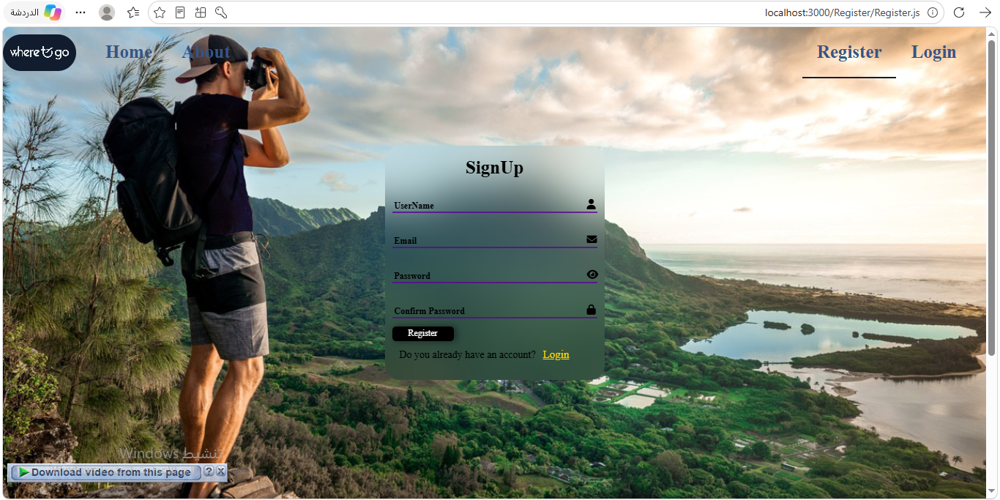
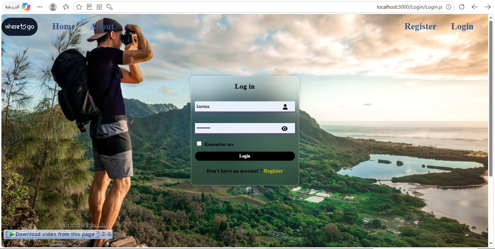

# Easy Trip - Travel & Booking Web Application (Frontend)

A responsive web application built with React.js designed to simplify trip planning and booking.

## My Contributions
As part of a collaborative development team, I was specifically responsible for designing and building the user authentication and informational interfaces:
* **User Registration Page (/Register):** Developed a responsive sign-up interface with structured form inputs and client-side validation.
* **User Login Page (/Login):** Built a clean, user-friendly login screen integrated with the application's routing and navigation.
* **About Page (/About):** Created the About section layout, responsive styling, and dynamic content rendering using reusable React components.

## Tech Stack
* Frontend: React.js, React Router, JavaScript (ES6+), HTML5, CSS3
* Data Handling: JSON

## Screenshots

### About Page

### Registration Page

### Login Page

## How to Run Locally
1. Clone the repository:
   `bash
   git clone [https://github.com/khadija306/easy-trip-frontend.git](https://github.com/khadija306/easy-trip-frontend.git)
2. Navigate to the project directory and install dependencies
  cd easy-trip-frontend
  npm install
3. Start the development server
    npm start